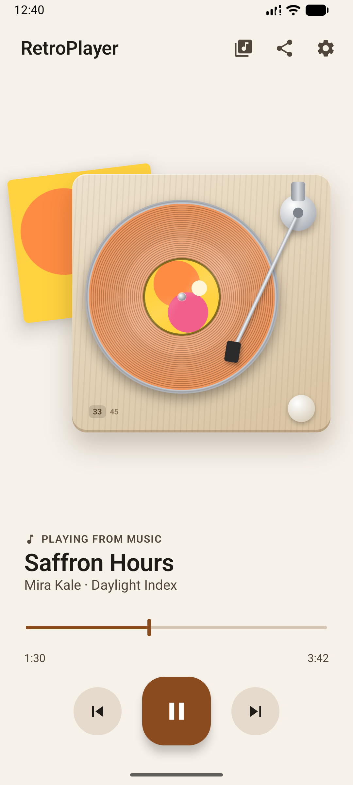
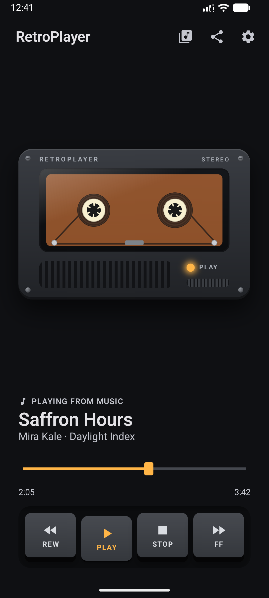
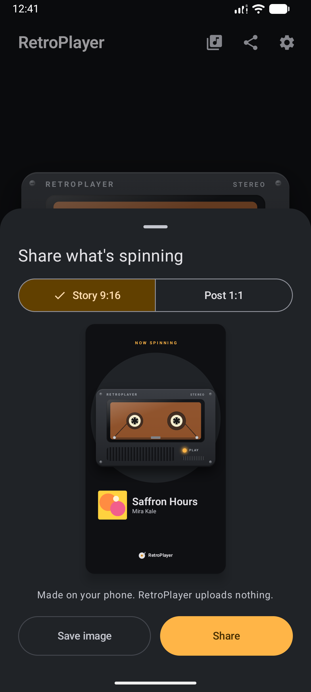
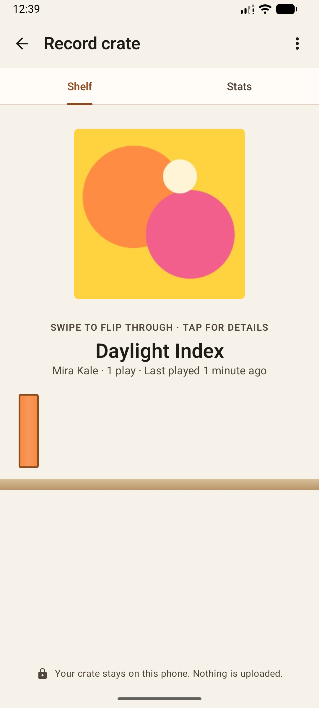

# RetroPlayer

Whatever's playing on your phone, shown as a spinning record or a ticking cassette.

RetroPlayer works with Spotify and any other music app that shows media controls. It was made for the Galaxy Z Fold, with layouts for both the cover screen and the inner screen, and it runs on any phone with Android 14 or newer.

[](https://github.com/noeldgr8/RetroPlayer/releases/latest/download/RetroPlayer.apk)

<p>
  
  
  
  
</p>

## Features

- **Four looks:** Vinyl Light, Vinyl Dark, Cassette Light and Cassette Dark. They can follow your phone's light and dark mode.
- **Records and tapes that match the album:** each album gets its own vinyl finish (translucent, marble, splatter or picture disc) or cassette shell, picked from the cover's colours.
- **Playback controls:** play, pause, skip and seek without opening your music app.
- **Home screen widgets** in three sizes, each with its own theme.
- **Made for foldables:** separate layouts for the cover screen, the inner screen and tabletop mode, plus a one-thumb mini deck for the folded phone.
- **Share cards:** turn what's playing into a story (9:16) or post (1:1) image.
- **Record crate:** a shelf of what you've been listening to, with play counts and stats.
- **Flip the sleeve:** tap the record sleeve or cassette J-card to see the album details on the back.

## Install

1. On your phone, tap **Download APK** above (or open the [latest release](https://github.com/noeldgr8/RetroPlayer/releases/latest)).
2. Open the downloaded `RetroPlayer.apk`. If Android asks, allow your browser or Files app to install unknown apps.
3. Open RetroPlayer and follow the setup. It asks for **notification access**, which is how it sees what's playing.

> **Notification access greyed out?** Android blocks this permission for apps installed from outside the Play Store until you allow it. Go to **Settings › Apps › RetroPlayer**, tap **⋮** in the top corner, choose **Allow restricted settings**, then turn on notification access again.

To update, download the newest APK and install it over the old one. Your settings and crate are kept.

## Privacy

RetroPlayer reads only the track title, artist, album and artwork from Android's media controls. It has no account and sends nothing over the internet. Your listening history (the crate) stays on your phone, and you can turn it off or clear it in Settings.

## Build it yourself

You need [Android Studio](https://developer.android.com/studio) (2026.2 or newer, which includes JDK 21+) and the Android SDK platform 37.

```bash
git clone https://github.com/noeldgr8/RetroPlayer.git
cd RetroPlayer
./gradlew assembleDebug
```

The debug APK is written to `app/build/outputs/apk/debug/`. It installs as **RetroPlayer Debug**, so it can sit next to the released app. Debug builds also include a **RetroPlayer Demo** launcher icon that plays a silent placeholder track, so you can try the app without a music app.

### Project layout

| Module | What's in it |
| --- | --- |
| `app` | Activity, navigation, onboarding and settings screens |
| `core:theme` | Colours, type and the four themes |
| `core:media` | Reads the current track through the notification listener |
| `core:settings` | Settings stored with DataStore |
| `core:history` | Record crate history (Room) |
| `feature:player` | The turntable, cassette deck and player layouts |
| `feature:share` | Share cards |
| `feature:crate` | Record crate screens |
| `widget` | Home screen widgets (Glance) |

Built with Kotlin, Jetpack Compose, Material 3, Glance, Room, DataStore, WindowManager and Hilt.

### Making a release

Releases are built and signed by GitHub Actions. Bump `versionCode` and `versionName` in `app/build.gradle.kts`, then push an annotated tag. The tag message becomes the release notes:

```bash
git tag -a v1.2.0 -m "What changed in this version"
git push origin v1.2.0
```

The [Release workflow](.github/workflows/release.yml) needs four repository secrets: `RETRO_KEYSTORE_BASE64`, `RETRO_KEYSTORE_PASSWORD`, `RETRO_KEY_ALIAS` and `RETRO_KEY_PASSWORD`.

## Licence

[MIT](LICENSE)
